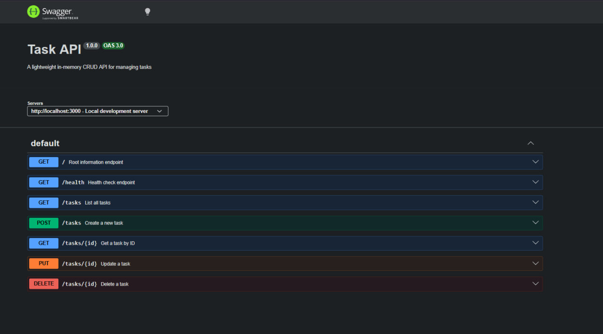

# Task API

A lightweight REST API built with **Express.js** that demonstrates CRUD (Create, Read, Update, Delete) operations using an in-memory array of tasks. The project also includes **Swagger UI** for interactive API documentation generated from JSDoc comments.

> **Note:** This project stores data in memory. Any changes made to tasks will be lost when the server restarts.

---

## Features

- Express.js REST API
- In-memory task storage
- CRUD operations
- Interactive Swagger documentation
- JSON request parsing
- Health check endpoint

---

---

## Database Setup

This project uses **PostgreSQL** running inside a Docker container. Data persists across container restarts using a Docker named volume (`taskdata`).

Start the Postgres container locally:

```bash
docker run --name taskdb -e POSTGRES_PASSWORD=dev -e POSTGRES_DB=tasks -p 5432:5432 -v taskdata:/var/lib/postgresql/data -d postgres:17

---

## Requirements

- Node.js 18+ (recommended)
- npm
- Docker Desktop or Podman[cite: 1]
- A database client like DBeaver, TablePlus, or `psql` CLI[cite: 1]
---

## Installation & Run

Clone the repository, install dependencies, and start the server:

```bash
npm install && npm start
```

After the server starts, visit:

- API: http://localhost:3000
- Swagger UI: http://localhost:3000/docs

---

## API Endpoints

| Method | Endpoint | Description |
|---------|----------|-------------|
| GET | `/` | Returns API information |
| GET | `/health` | Health check endpoint |
| GET | `/tasks` | Returns all tasks |
| POST | `/tasks` | Creates a new task |
| GET | `/tasks/:id` | Returns a task by ID |
| PUT | `/tasks/:id` | Updates an existing task |
| DELETE | `/tasks/:id` | Deletes a task |

---

## Example Response (`curl -i`)

Request:

```bash
curl -i http://localhost:3000/health
```

Example Output:

```http
HTTP/1.1 200 OK
X-Powered-By: Express
Content-Type: application/json; charset=utf-8
Content-Length: 15
ETag: W/"f-VaSQ4oDUiZblZNAEkkN+sX+q3Sg"
Date: Mon, 27 Jul 2026 10:15:00 GMT
Connection: keep-alive
Keep-Alive: timeout=5

{"status":"ok"}
```

---

## Swagger Documentation

Interactive API documentation is available at:

```
http://localhost:3000/docs
```

### Screenshot

> Replace the placeholder image below with your own Swagger UI screenshot.




---

## Project Structure

```text
.
├── index.js
├── package.json
├── README.md
└── docs
    └── swagger-demo.png
```

---

## Technologies Used

- Express.js
- Swagger UI Express
- swagger-jsdoc
- Node.js

---

## License

This project is intended for learning and demonstration purposes.